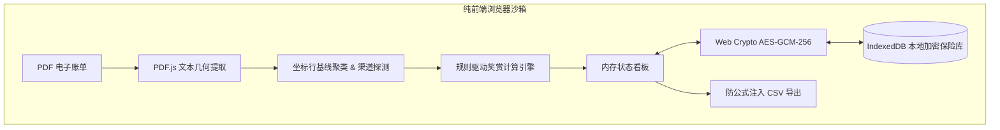

# CardPulse 💳⚡

**Next-Gen Privacy-First Credit Card Statement Analyzer & Cashback Ledger**  
多币种信用卡电子结单本地解析与返现中枢 · 纯端侧零知识加密 · 主副卡闭环对账

[](LICENSE)
[](https://react.dev/)
[](https://vitejs.dev/)
[](#隐私与安全承诺)
[](#运行测试)

---

## 🌟 为什么需要 CardPulse？

中港双币与境外信用卡（如 **HSBC Pulse 脉搏银联双币卡**、**HSBC Red 卡** 等）具有丰厚的返现权益，但普遍存在以下痛点：

1. **复杂的权益与分级封顶规则**：
   - 基础返现（0.4% RC 无上限）
   - 赏世界 5x（额外 2%，年限额 CNY 100,000）
   - PULSE 专属内地奖赏（Apple Pay / 银联二维码 额外 2%，半年限额 CNY 80,000，7月1日刷新）
   - **退款扣回返现但绝不释放已占用的消费额度**
2. **极高的隐私敏感性**：结单包含持卡人姓名、卡号、交易明细与生活轨迹，绝不可上传至第三方云端服务器。
3. **传统工具刷新即丢失**：缺乏安全的本地持久化能力，每次都需重复拖入整年 PDF。

**CardPulse** 应运而生：基于纯前端浏览器本地沙箱，提供**端侧零知识加密存储**、**几何坐标聚类解析**、**会计级对账核算**与**可扩展卡片规则引擎**。

---

## ✨ 核心特性

- 🛡️ **绝对隐私保障（Zero-Knowledge Privacy）**
  - 无业务后端、无数据上报接口；
  - 采用 **Web Crypto API（PBKDF2 100,000 次密钥派生 + AES-256-GCM）** 加密本地存储（IndexedDB）；
  - 只有输入您设置的主密码才能在本地浏览器解密，刷新页面数据依然安全驻留。
- 📐 **基于几何坐标的 PDF 聚类还原**
  - 基于 `pdfjs-dist`，针对 PDF 文本图层按 $y$ 基线容差聚行、按 $x$ 轴比例分列，还原受支持布局的交易表；
  - 准确识别多行钱包备注（如 Apple Pay、UnionPay QR 自动挂回上一笔消费）。
- 🧮 **会计级精度闭环核算**
  - 全局采用 `BigInt` 以分或十万分之一元为基本运算单位，杜绝浮点数精度漏洞；
  - 自动执行账单结欠平衡校验：$\text{上期结欠} + \text{借方净支出} - \text{贷方净入账} = \text{本期结欠}$。
- 🧩 **规则驱动的卡种引擎（Rule-Driven Architecture）**
  - 解耦卡种逻辑，当前看板实现 HSBC Pulse 规则；HSBC Red 仅支持卡种与渠道识别、交易查阅和导出，尚未接入返现核算。
- 🛡️ **安全 CSV 导出**
  - 内置防范电子表格公式注入攻击（CSV Formula Injection Sanitization），导出文件安全无虞。

---

## 🚀 快速上手

### 环境要求
- Node.js $\ge$ 20.0.0
- 现代浏览器（支持 Web Crypto、Web Worker、IndexedDB）

### 启动开发服务器
```bash
# 1. 安装依赖
npm install

# 2. 运行本地开发环境
npm run dev
```
打开浏览器访问终端提示的本地地址（如 `http://localhost:5173`）。

### 运行单元测试
项目使用 Node.js 原生测试套件：
```bash
npm test
```

仓库提供 [GitHub Actions CI 模板](docs/ci.yml)，配置了 Node.js 22/24 的测试与生产构建。当前 GitHub 凭证缺少 `workflow` 权限，模板尚未启用；获得相应权限后，将其放入 `.github/workflows/ci.yml` 即可启用。

### 构建生产包
```bash
npm run build
npm run preview
```
打包输出于 `dist/` 目录，可直接部署在任意静态托管平台（Cloudflare Pages、Vercel、GitHub Pages 等）。

---

## 导入与保存

- 可批量导入 PDF；同一文件即使改名，也按内容指纹跳过，避免重复计账。内容不同的 PDF 不做跨文件交易去重，重叠结单仍需人工检查。
- 加密 PDF 会提示输入密码，错误后可重试，取消则跳过该文件继续处理后续文件。
- 导入后点击“保存到加密库”；后续新增结单仍须手动保存，并输入现有主密码。界面会提示未保存的修改。
- “锁定保险库”会清除当前交易及结单的内存状态，解锁后恢复已保存版本；“清空数据”会在确认后同时删除内存交易与本地保险库。
- 对账按币种显示：一致、不符（含差额）或未验证。缺少期初/期末结欠时不会报告成功。
- 汇率获取失败时不使用固定猜测值；有港币返现时，人民币折算总额显示为未知。

### 当前解析边界

当前支持带英文 `POST DATE` / `TRANS DATE` 表头、英文月份及固定相对列位置的文字型结单。页面表头上方须有唯一可识别的币种。无法识别的币种、交易行或空结单会提示人工核查；扫描件尚不支持 OCR。对账识别英文期初/期末结欠标签，其他格式会显示未验证。解析器测试采用合成坐标数据，仍需更多脱敏真实结单验证版式兼容性。

返现数值按仓库内置规则估算，未自动核验银行最新活动资格和条款；Red 卡交易不计入 Pulse 看板。已有早期保险库中的交易仍可读取，但旧记录没有文件指纹和结单摘要，重新导入前需人工排除重复。

## 🏗️ 架构概览



---

## 🔒 隐私与安全承诺

1. **零后端与零上传**：所有 PDF 文件、解析文本和账单记录仅在用户本机的浏览器内存中运行。
2. **汇率安全策略**：获取公开日度汇率时，使用 `credentials: 'omit'` 与 `referrerPolicy: 'no-referrer'`，绝不夹带任何凭证或上下文。
3. **主密码自持**：主密码不对外传输或哈希存储，一旦忘记密码无法找回，确保数据资产所有权绝对归用户所有。

---

## 🛣️ 路线图 (Roadmap)

- [x] 端侧 AES-256-GCM 本地加密保险库
- [x] HSBC Pulse 双币信用卡解析与返现精算
- [x] 会计级 Balance Reconciliation 对账闭环
- [x] 安全 CSV 导出与公式注入防护
- [ ] 扩展支持中银香港（BOC HK）Cheers 卡与信银国际（CNCBI）Motion 卡
- [ ] 本地离线 OCR（Tesseract.js WASM）针对扫描件的图像识别支持
- [ ] Beancount / Ledger 纯文本复式记账语法一键导出
- [ ] 刷卡策略实时模拟器（Rebate Swipe Advisor）

---

## 📄 许可证

本项目基于 [MIT License](LICENSE) 开源。

*免责声明：CardPulse 是由社区独立开发的辅助工具，与汇丰银行（HSBC）或任何发卡机构均无官方关联。返现估算结果仅供参考，请以银行实际结单及最终记账记录为准。*
